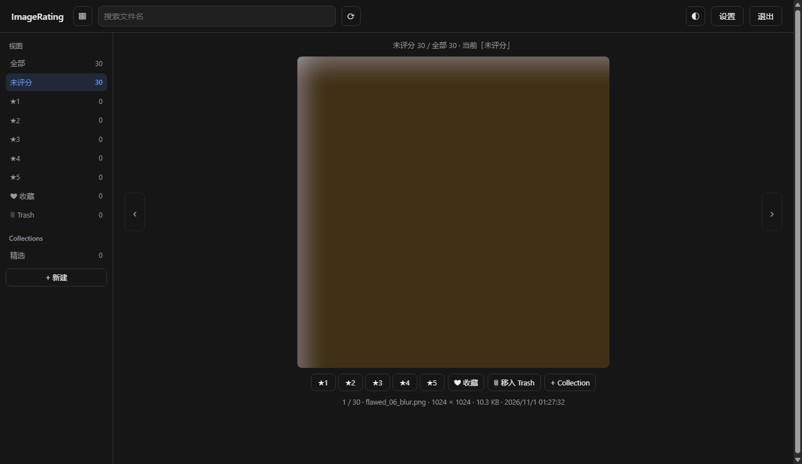
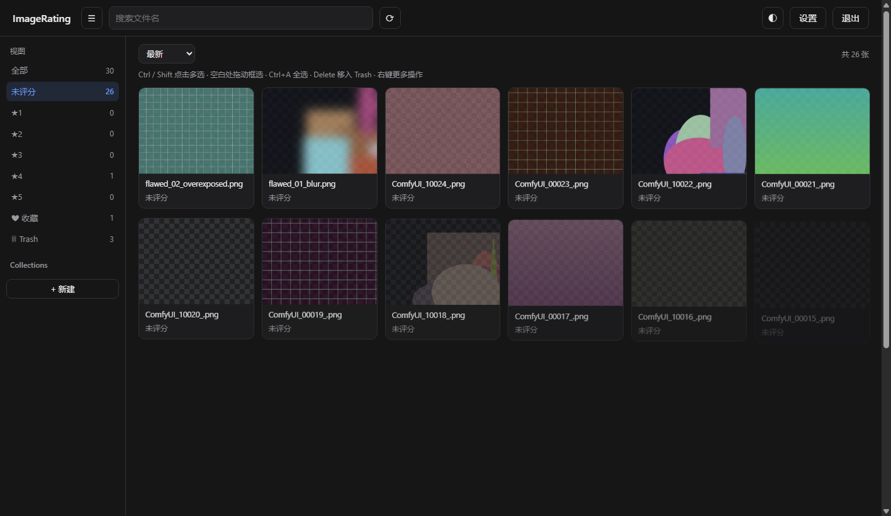
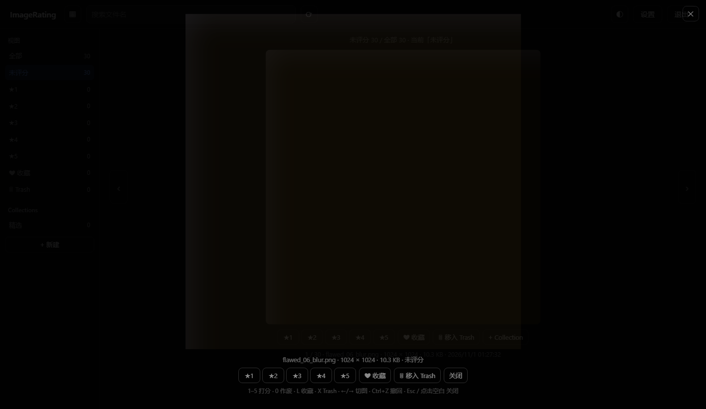
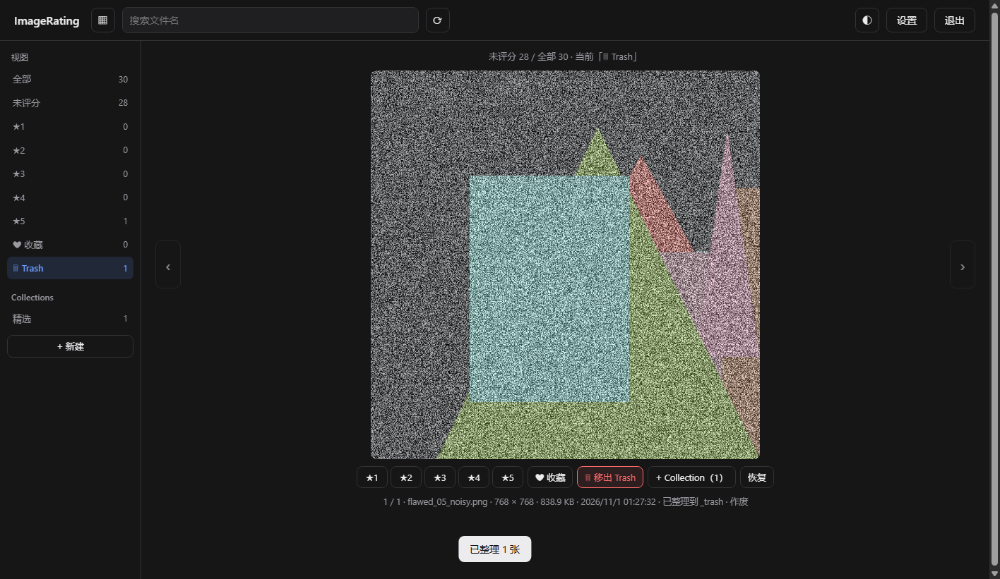
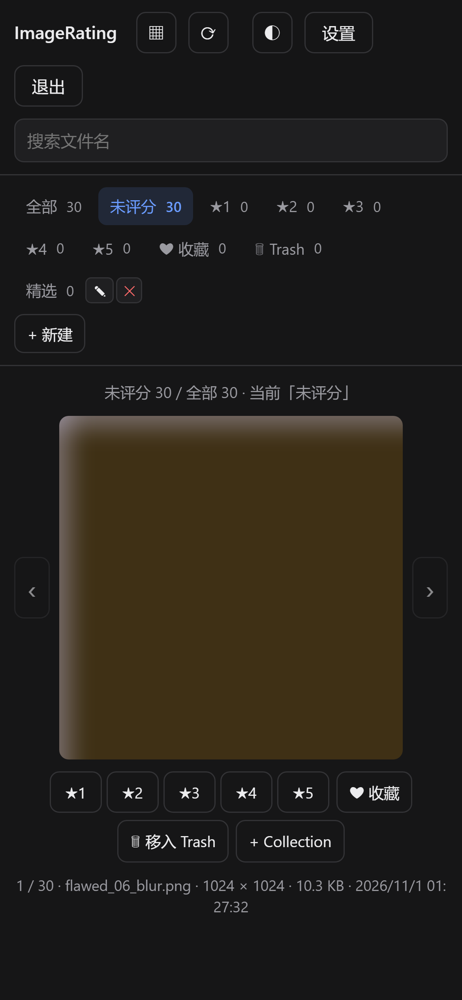
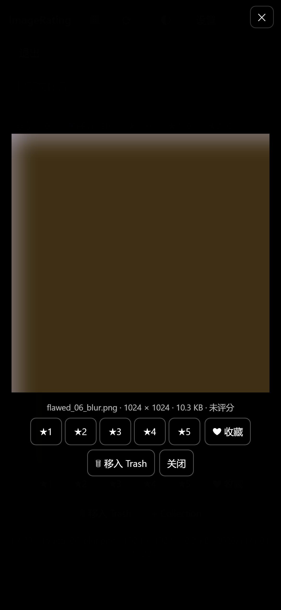

# ImageRating

**v0.2.1**

ComfyUI 出图评分与归档工具：一个跑在 ComfyUI 主机上的本地 Web 应用，浏览器输密码访问。
评分只写数据库（图片 Meta），Collection 负责归档，Trash 是内置集合；**判分与归档都不动磁盘文件**，只有你显式点「物理整理」时才把 Trash 里的图移到 `_trash/` 子目录，且可一键恢复。

## 界面预览

| Ranking：单图评分 | Grid：网格批量 |
|---|---|
|  |  |

| 灯箱：整屏看细节 | 物理整理：Trash 移入 `_trash/` |
|---|---|
|  |  |

手机版（验证视口 390 × 844）：

| Ranking | 灯箱 |
|---|---|
|  |  |

## 当前能力

- **Ranking 视图**：一张大图，快捷键 `1`–`5` 打分、`0` 作废、`L` 收藏，打完自动下一张
- **灯箱**：点击大图 / 按 `F` / 网格双击卡片 / 抽屉「⤢ 看大图」，放大到整屏看细节，打分等快捷键照常可用
- **`Ctrl+Z` 撤回**：打分、收藏、Trash、Collection 操作都能一步步撤回（最多 50 步，刷新页面后清空）
- **Grid 视图**：缩略图网格、无限滚动、多选 / 框选、批量打分 / 收藏 / 移入 Trash / 加入 Collection
- **搜索与排序**：按文件名搜索；最新 / 最早 / 高分优先 / 低分优先 / 随机排序
- **Collections**：多对多分组，可新建、重命名、删除；一张图可属于多个 Collection
- **Trash**：内置集合；打 `0` 分自动进入，重新打 `1`–`5` 分自动移出
- **物理整理**：把 Trash 中的图移入 `<图片根目录>/_trash/`，可一键恢复原位（不删除任何文件）
- **目录递归扫描（增量）**、512px WebP 缩略图缓存、单密码登录、局域网访问
- **手机版**：整站响应式，手机浏览器可直接评分与看大图
- **深色 / 浅色主题**：跟随系统，也可在顶栏手动切换

## 核心概念

| 概念 | 说明 |
|---|---|
| `score` | `null` 未评分；`0` 有明显瑕疵作废；`1..5` 星级 |
| `loved` | 独立收藏标记，与 Collection 无关 |
| Collection | 用户创建的多对多分组，一张图可属于多个 |
| Trash | 内置集合，用 `trashed` 字段表示，不可删除；打 0 分自动进，打 1–5 分自动出 |
| 物理整理 | 只把 Trash 中的图移到 `<根目录>/_trash/`，可恢复，**不删除** |
| `missing` | 磁盘上找不到文件；默认从列表和统计里隐藏，重新扫描可恢复 |
| 物理整理标记 | `rel_path` 以 `_trash/` 开头即视为已整理；这类记录不会被扫描误标为缺失 |

## 快速开始

### 环境要求

- [uv](https://docs.astral.sh/uv/) 0.6+（依赖由它管理）
- Python 3.10+（uv 会自动选可用解释器；开发环境验证过 3.12 / 3.13）
- 依赖：FastAPI、uvicorn、Pillow，版本由 `pyproject.toml` + `uv.lock` 锁定

### 在 ComfyUI 主机上部署

1. 把本仓库拷到 ComfyUI 主机（例如 `D:\Desktop\ImageRating`）。
2. 安装 uv（只需一次，已装可跳过）：

   ```powershell
   winget install --id=astral-sh.uv -e
   # 或
   python -m pip install uv
   ```

3. 启动（三种任选，效果相同）：

   ```powershell
   .\start.bat        # Windows 双击也行
   .\run.ps1          # Windows PowerShell
   ./run.sh           # Linux / macOS（首次先 chmod +x run.sh）
   ```

   它们都等价于 `uv run python -m app`；`uv run` 会按 `pyproject.toml` / `uv.lock` 自动创建 `.venv` 并补齐依赖。
   启动日志会打印本机与局域网访问地址，默认端口 **17900**、监听 `0.0.0.0`：

   - 本机：`http://127.0.0.1:17900`
   - 局域网：`http://<这台机器的IP>:17900`

   如需改端口 / 监听地址，把 `config.example.json` 复制成 `config.json` 后修改。

4. 首次启动时 Windows 防火墙可能弹窗，允许「专用网络」访问，否则同网段设备连不上。
5. 浏览器打开 `http://<ComfyUI主机IP>:17900`：
   - 首次使用会要求设置访问密码（至少 4 位）
   - 进设置页把「图片根目录」填成 ComfyUI 的输出目录（例如 `D:\ComfyUI\output`）
   - 点顶栏的 ⟳ 扫描，扫描完成后就能开始打分

更细的部署、开机自启、备份与排障见 [docs/DEPLOYMENT.md](docs/DEPLOYMENT.md)。

## 上手流程

1. **设置根目录并扫描**：设置页填入 ComfyUI 输出目录，保存后自动扫描；之后点 ⟳ 增量扫描。
2. **Ranking 打分**：在「未评分」视图逐张过，按 `1`–`5` 打星；有明显瑕疵按 `0` 作废。
3. **Grid 批量整理**：切到 Grid，多选后批量打分 / 收藏 / 移入 Trash / 加入 Collection。
4. **Collection 归档**：新建 Collection（如「精选」「待修」），把图加进去；一张图可属于多个。
5. **Trash 与物理整理**：确认不要的图进 Trash；需要腾目录时点「物理整理」，文件移到 `_trash/`，随时可恢复。
6. **反悔就 `Ctrl+Z`**：打分、收藏、Trash、Collection 都能逐步撤回；物理整理用「恢复」而不是撤回。

## 快捷键

| 键 | 作用 |
|---|---|
| `1`–`5` | 打 1–5 星，并自动跳下一张 |
| `0` | 有明显瑕疵作废（打 0 分，自动进 Trash） |
| `Ctrl`+`Z` | 撤回上一步打分 / 收藏 / Trash / Collection |
| `F` / 点击大图 | 打开 / 关闭灯箱（网格里选中一张后按 `F` 也行） |
| `L` | 切换收藏（loved） |
| `X` | 移入 / 移出 Trash |
| `←` `→` | 上一张 / 下一张 |
| `G` | Ranking / Grid 视图切换 |
| `C` | 把当前图加入 Collection |
| `?` | 快捷键说明 |
| `Ctrl+A` | Grid 视图全选已加载 |
| `Delete` | Grid 视图把选中图移入 Trash |
| `Esc` | 关闭灯箱 / 取消选择 / 关闭弹窗 |

灯箱打开时打分、收藏、Trash、`←/→`、`Ctrl+Z` 全部照常可用；网格里双击缩略图、右键「大图查看」或详情抽屉里的「⤢ 看大图」也能开灯箱。

## 数据与备份

- `data/rating.db`：SQLite 数据库（评分、收藏、Collection、Trash、根目录配置、密码哈希、会话密钥）。**备份这个文件即可保住全部记录。**
- `data/thumbs/`：缩略图缓存，可随时删除，会自动重建。
- `config.json`：仅 `host` / `port` / `data_dir` 三个部署参数，可选。
- 以上都在 `.gitignore` 里，不会进版本库。

在线 / 离线备份命令、恢复步骤与迁移方法见 [docs/DEPLOYMENT.md](docs/DEPLOYMENT.md#8-数据与备份)。

## 项目结构

```
app/          FastAPI 后端（路由、SQLite、鉴权、扫描）
web/          原生 HTML/CSS/JS 单页前端（无构建）
tests/        unittest + TestClient 集成测试、合成样图生成器
docs/         API 契约、架构、部署、开发文档与界面截图
run.ps1 / run.sh / start.bat   启动脚本
pyproject.toml / uv.lock       依赖声明与锁定（uv）
```

## 开发与测试

```powershell
# 单元 / 集成测试（用临时数据库与合成图片，不碰真实数据）
uv run python -m unittest discover -s tests -v

# 生成合成样图（含明显瑕疵图，用于手动验证 Ranking 手感）
uv run python tests/make_samples.py --out .\tests\samples --count 24 --flawed 6
```

依赖变化时用 `uv add <包名>` / `uv add --dev <包名>`，`uv.lock` 一并提交。
开发流程、测试地图、手动验证清单与发布检查见 [docs/DEVELOPMENT.md](docs/DEVELOPMENT.md)。

## 常见问题

**评分或分组会移动 / 删除我的图片吗？**
不会。只有「物理整理」和「恢复」会移动文件，且只在 Trash 与 `<根目录>/_trash/` 之间移动，不删除任何文件。

**局域网其他设备打不开？**
先确认本机 `http://127.0.0.1:17900` 能打开；再检查 Windows 防火墙是否放行「专用网络」、`config.json` 的 `host` 是否为 `0.0.0.0`、两台设备是否同一网段。详见 [部署与运维](docs/DEPLOYMENT.md#6-局域网访问)。

**忘记密码了怎么办？**
停止服务后按 [重置密码](docs/DEPLOYMENT.md#忘记密码重置不丢评分) 清掉密码哈希再启动，评分与 Collection 都不会丢。

**换电脑 / 换目录怎么迁移？**
备份 `data/rating.db`；新机器上改「图库根目录」并重新扫描即可，评分按相对路径匹配。步骤见 [迁移](docs/DEPLOYMENT.md#84-迁移到另一台机器)。

**能直接暴露到公网访问吗？**
不建议。应用是 HTTP 明文、单密码、无登录限速，只适合可信局域网；远程访问请用 VPN 或 SSH 隧道。

**扫描很慢？**
首次扫描要读每张图的尺寸并建索引，图多时会慢；之后只处理新增 / 变化的文件。缩略图是打开页面时按需生成的。

## 文档

- [`docs/API.md`](docs/API.md)：前后端唯一契约，改接口先改这里。
- [`docs/ARCHITECTURE.md`](docs/ARCHITECTURE.md)：模块职责、数据模型、扫描 / 整理流程、并发与安全。
- [`docs/DEPLOYMENT.md`](docs/DEPLOYMENT.md)：安装、开机自启、备份恢复、日常运维、故障排查。
- [`docs/DEVELOPMENT.md`](docs/DEVELOPMENT.md)：开发环境、契约改动流程、测试与手动验证、发布清单。
- [`AGENTS.md`](AGENTS.md)：给编码 Agent 的项目约束与验证方式。
- `docs/screenshots/`：界面截图。

## 更新日志

### 0.2.1

- 修复：灯箱在关闭状态仍被 CSS `display: flex` 强制显示，首次打开页面会出现一屏按钮遮罩挡住界面（`dialog` 关闭时必须保持 `display: none`，只有 `[open]` 时才铺满）
- 灯箱打开时快捷键、手机视口行为不变

### 0.2.0

- 新增 `Ctrl+Z` 撤回：打分、收藏、Trash、Collection 操作可逐步撤回
- 新增灯箱：Ranking 点击大图 / `F`、网格双击卡片 / 右键「大图查看」、抽屉「⤢ 看大图」，放大到整屏且快捷键全部可用
- 新增手机版：整站响应式布局（侧边栏折叠为筛选条、网格两列、抽屉全屏、灯箱适配触屏）
- 设置页显示版本号

### 0.1.0

- 首个版本：Ranking / Grid、评分与 Trash 联动、loved、Collections、物理整理与恢复、密码登录、缩略图缓存

## 暂未实现（后续候选）

- 展示 ComfyUI PNG 内嵌的 prompt / workflow 元数据
- 按 Collection 把文件物理归档到各自文件夹
- 图片对比模式（同 prompt 多 seed 并排）
- 物理删除图片文件（当前只会移入 `_trash/`）
